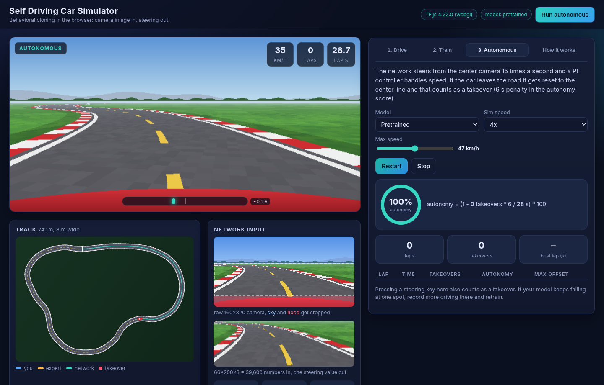
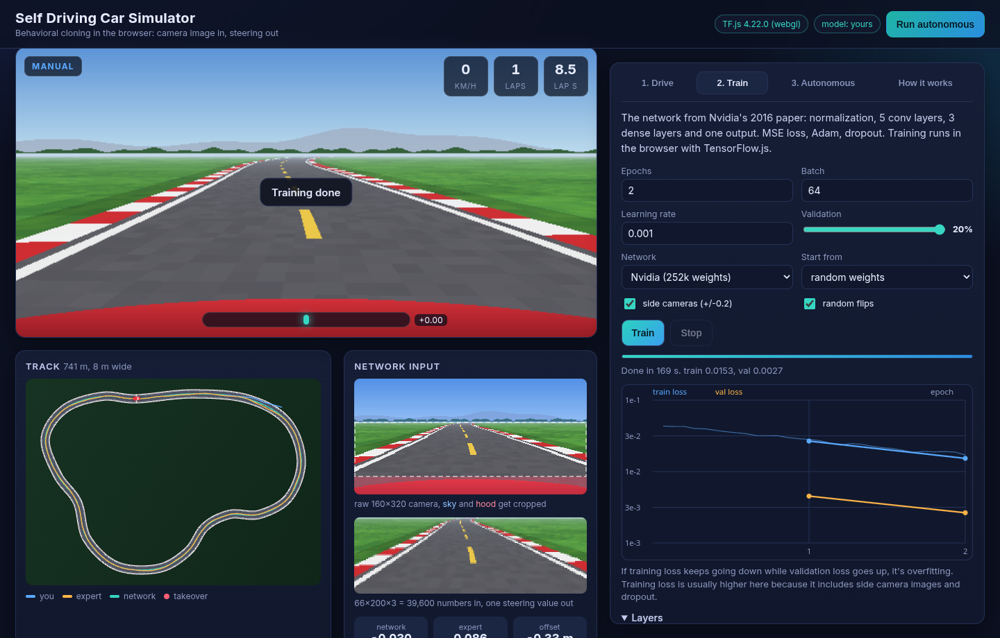

# Self Driving Car Simulator

A small behavioral cloning project. You drive a car around a track, it records what the dashcam sees and how you steer, and a CNN learns to steer from the camera image alone. Then you let it drive.

There are two parts. `web/` is a simulator that runs in the browser, with training done in TensorFlow.js. `python/` is Keras code for the Udacity simulator, which is the original setup this kind of project is usually built on.

Live demo: https://hrutishaa.github.io/self-driving-car-sim/

The repo comes with a pretrained model, so you can hit "Run autonomous" right away. Adding `?auto=1` to the URL starts it on load.



## How it works

I followed Hari's guide on teaching a car to drive in a simulator, which in turn is based on Nvidia's 2016 paper "End to End Learning for Self-Driving Cars". The idea is that one network goes straight from pixels to a steering angle, with no lane detection code.

The dashcam renders a 160x320 image. The top 60 rows (sky) and bottom 25 rows (hood) are cropped off and the rest is resized to 66x200, which is what the network gets as input. Every 0.1 s while recording, the app saves the center, left and right camera images together with the steering angle (-1 to 1).

For training, 20% of the recorded frames are held out for validation (you can set anything between 10 and 20%). The left and right camera images are used with the steering shifted by +0.2 and -0.2, and images get flipped randomly with the steering sign flipped. Without that the network mostly learns to go straight, since most of a lap is straight.

The model is the Nvidia layout: a normalization layer, 5 conv layers (24, 36, 48 filters at 5x5 stride 2, then two 64 filter 3x3 layers), dropout, and dense layers of 100, 50 and 10 into one output. About 252k weights, trained with MSE and Adam. There's also a "lite" option with half the filters, in case training is too slow on your phone.

In autonomous mode the network steers 15 times per second and a PI controller handles the throttle. If the car leaves the road it gets put back on the center line and that counts as a takeover. The score is Nvidia's autonomy metric, (1 - takeovers * 6 / seconds) * 100.

The "How it works" tab has the examples from the guide: the edge filter (1 1 8 8 8 with filter -1, +1 gives 0 7 0 0) and the gradient descent toy, where w goes -1, 0.4, 0.68, 0.736 and the guess ends up near the target of -15.



## The simulator

The track is a 741 m loop made from a spline, 8 m wide, with both left and right turns. Around the center line there's a distance field, which both the physics and the camera renderer use. The camera is plain JS that projects every pixel onto the ground and colors it based on distance from the center line. Because it doesn't touch the DOM, node can run the exact same code, and that's how the pretrained model was made.

The car uses a kinematic bicycle model. If you don't feel like driving there's an "Auto-record expert laps" button. A pure pursuit driver goes around the track while random steering kicks push it off center. The recorded label is always what the expert wanted to steer, so the data shows how to get back to the middle, which you'd otherwise have to record by hand.

## Pretrained model

`tools/train-pretrained.mjs` records 8 expert laps (5,347 frames), trains for 10 epochs with tfjs-node (about 2 minutes on my laptop CPU) and writes the model to `web/model/`. When it then drives on its own it does 3 laps with no takeovers, never more than about 0.5 m from the center line. With extra random steering kicks it still finishes the lap. The numbers are in `web/model/meta.json`.

## Running the web app

No build step. Any static server works, because ES modules don't load from `file://`:

```
node tools/serve.mjs 8080
# or: python3 -m http.server -d web 8080
```

Then open http://localhost:8080/. Arrow keys or WASD to drive, R to record. On a phone there are touch buttons.

If you want to retrain the shipped model or run the browser test, run `npm install` first. Then `npm run pretrain` rebuilds `web/model/`, and `npm run verify` runs the app in headless Chrome. The test checks that the pretrained model gets around a lap without leaving the road, that recording and training work, and that the explainer numbers are right. It also retakes the screenshots in `docs/`. It expects Chrome at `/usr/bin/google-chrome`; you can set `CHROME_PATH` to use a different one.

## Running the Python part

```
cd python
python -m venv .venv
source .venv/bin/activate
pip install -r requirements.txt
python test_smoke.py
```

`test_smoke.py` doesn't need the simulator. It trains for two epochs on fake images and sends a few messages to `drive.py` the same way the simulator would.

With the real simulator, record a few laps in training mode (include some recoveries from the edge), put `driving_log.csv` and the `IMG` folder in `python/data`, then:

```
python model.py -d data -n 10
python drive.py model.keras
```

and start the simulator in autonomous mode. `drive.py` applies the same crop and resize as training, which matters a lot. The Udacity sim is from 2017 and only works with old socket.io versions, which is why `python-socketio` and `python-engineio` are pinned in requirements.txt. If the sim won't run on your machine, the Donkey Car simulator is a free alternative. The preprocessing and model code work the same with it, but you'd have to swap out the networking part.

## Deploying

The workflow in `.github/workflows/pages.yml` publishes `web/` to GitHub Pages on every push to main. To set it up:

1. Create an empty repo on GitHub (I called mine `self-driving-car-sim`). Don't add a README or license, since they're already here.
2. Push:
   ```
   git remote add origin https://github.com/<username>/self-driving-car-sim.git
   git push -u origin main
   ```
3. In the repo, go to Settings > Pages and set Source to "GitHub Actions". If the first workflow run failed because Pages wasn't on yet, re-run it from the Actions tab.

After a minute or so the site is up at `https://<username>.github.io/self-driving-car-sim/`. The URL also shows in the Actions run and under Settings > Pages. Then replace https://hrutishaa.github.io/self-driving-car-sim/ near the top of this README with it. All paths in the app are relative, so it works fine under the repo sub-path.

## Limitations

It's a teaching project. The world is flat and stylized, there's only one track and the car physics are simple. Recorded data stays in memory (capped at 4,000 frames) and is gone when you reload the page. How fast training goes depends on your GPU. The Python code has been tested with fake data and a fake simulator client, but not against the actual Udacity build.

## Credits

- Hari ([@harixganesh](https://x.com/harixganesh)), "Teaching a car to drive in a simulator: how it works and how to build it", which this project follows.
- M. Bojarski et al., [End to End Learning for Self-Driving Cars](https://arxiv.org/abs/1604.07316), Nvidia, 2016.
- Udacity's [behavioral cloning project](https://github.com/udacity/CarND-Behavioral-Cloning-P3) and [simulator](https://github.com/udacity/self-driving-car-sim).
- [naokishibuya/car-behavioral-cloning](https://github.com/naokishibuya/car-behavioral-cloning), which I used as a reference for the preprocessing and augmentation.

## License

MIT, see [LICENSE](LICENSE).
